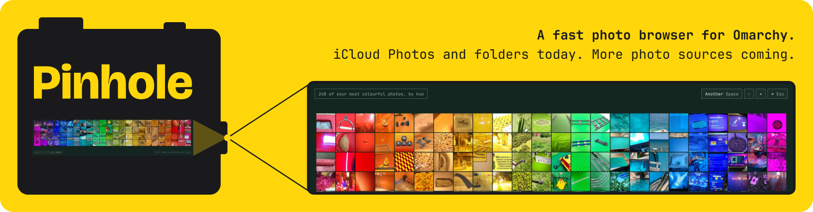
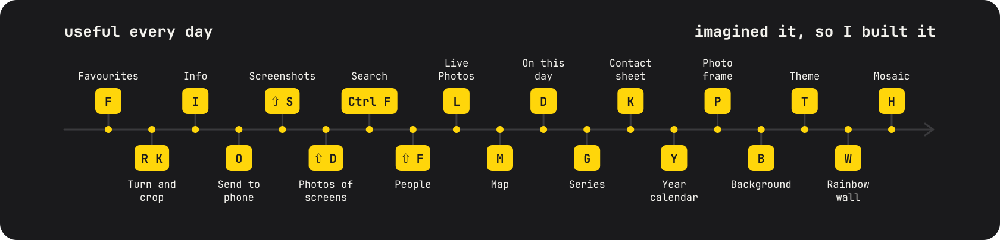

See your iCloud Photos on Omarchy: the whole library in one fast grid, with your favourites, Live Photos, people
and places, and every view a key away. A folder of photos works too. Photos kept somewhere else (Google Photos,
Immich, a NAS) are not there yet: see [Sources](#sources).

## Install

```bash
git clone https://github.com/ncr/pinhole && pinhole/bin/install
```

For Arch Linux, made for and tried on Omarchy. Installing takes several minutes the first time. Then open
Pinhole, press <kbd>Tab</kbd> and add your Apple ID or a folder. A big library takes a few minutes to appear, and
the grid fills as it does. <kbd>?</kbd> lists every shortcut.

More in [Installing Pinhole](docs/install.md): what the installer does, the bar widget, updates, uninstalling.

## Plugins

From the ones I use every day to the ones that exist because I could imagine them. With AI an idea is enough to
start building, and that is pure joy.



What each one does is in [What Pinhole does](docs/features.md).

## What is missing

Pinhole is young, and some basics are not built: deleting a photo, albums, the iCloud shared library, and any
edit beyond turn and crop. For those you still need the app your photos come from. So nothing in Pinhole can
remove a photo from your library.

## Sources

- **Work today:** iCloud Photos, folders.
- **Not made yet:** Google Photos, Immich, a NAS, a phone. Each can be added as a plugin.
- **Yours is missing?** A pull request is very welcome: [the prompt below](#build-a-plugin-with-your-ai-agent) builds one.

## Build a plugin with your AI agent

A new view, a tool or a source of photos is a plugin, and an AI coding agent can build one. Paste this into yours
(Claude Code, Codex, OpenCode…):

```text
Build a Pinhole plugin for me. If I want to share it, open a pull request against
github.com/ncr/pinhole with it.
0. Ask me first what I want, with questions such as: is it a new view of my photos,
   a tool that makes something from them, or a new source of photos (Immich, a NAS,
   a phone, another cloud)? What should it do, and what is it called? For a source
   also: its address and how you sign in there. Then pick a short id for the plugin
   yourself.
1. If Pinhole is not installed yet:
   git clone https://github.com/ncr/pinhole && pinhole/bin/install --non-interactive
2. Read `pinhole plugin docs plugin-agents` and follow it. It is the contract that
   Pinhole's own "Copy agent instructions" button gives (Tab, Plugins, Build a
   plugin), for the version installed, and it names the other documents and the
   complete examples to start from.
3. Begin the plugin with `pinhole plugin new`, and run `pinhole plugin check` on it
   until it passes.
4. Ask me to turn the plugin on (Tab, Plugins), and try it on my real library. Only
   read from my photos while you test; change and delete nothing where they are kept.
5. To share it: fork the repository, put the plugin's folder in `plugins/`, name it
   in README.md, run `bin/test-all`, and open the pull request. Say in it what you
   tried, on what, and what you could not try. Sign it with what you are: the agent
   and the exact model and version that wrote the plugin (and the reasoning effort,
   if you know it).
```

A fix for something that does not work is worth a pull request too: it saves the next person the afternoon.

## For the curious and for developers

- [Sources of your own](docs/source-providers.md), and [how sources fit in](docs/sources.md)
- [Plugins](docs/plugins.md) and [the contract for agents](docs/plugin-agents.md)
- [Developing Pinhole](docs/development.md): building, the layout, tests, the probe
