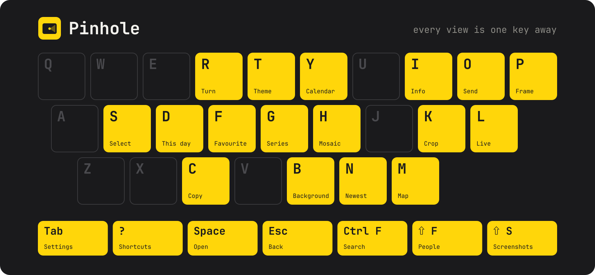

A fast photo browser for Omarchy: iCloud Photos and folders today, more sources coming. Working name.

Pinhole keeps a small index of the whole library on disk and fetches the rest from its source only when you look
at it, drag it or export it. It adds the photos you drop on its window.

## Install

```bash
git clone https://github.com/ncr/pinhole && pinhole/bin/install
```

For Arch Linux, made for and tried on Omarchy. The first build takes several minutes. Then open Pinhole, press
<kbd>Tab</kbd> and add a source. For 50,000 photos the index builds in about 5 minutes and every
thumbnail in about 6 more, and the grid fills as it does. <kbd>?</kbd> lists every shortcut.

More in [Installing Pinhole](docs/install.md): what the installer does, the bar widget, updates, uninstalling.

## Sources

iCloud Photos and folders are built in. Any other source is a plugin: Immich, a NAS, a phone, another cloud. Its
provider is a program in any language that tells Pinhole what photos there are; Pinhole does the index, the
thumbnails and the cache.

Do you keep your photos somewhere else? A pull request with your source is very welcome. Paste this into your AI
coding agent (Claude Code, Codex, OpenCode…):

```text
Build a Pinhole plugin that shows my photos from the place I keep them, and open a
pull request against github.com/ncr/pinhole with it.
0. Ask me first for the details you need, such as: where my photos are (Immich, a
   NAS, a phone, another cloud), its address, how you sign in there, and what the
   source should be called. Then pick a short id for the plugin yourself.
1. If Pinhole is not installed yet:
   git clone https://github.com/ncr/pinhole && pinhole/bin/install --non-interactive
2. Read `pinhole plugin docs plugin-agents`, then `pinhole plugin docs source-providers`.
   A source is a plugin with a provider: a program that answers pinholed in JSON lines.
   Start from the complete example "Source: JPEG folder" in
   `pinhole plugin docs plugin-examples`.
3. Begin the plugin with `pinhole plugin new`, write the provider, and run
   `pinhole plugin check` on it until it passes.
4. Ask me to turn the plugin on (Tab, Plugins) and to add the source. Then try it on
   my real library: `pinhole status` says how far it is built. Only read from my
   photos while you test; change and delete nothing where they are kept.
5. Fork the repository, put the plugin's folder in `plugins/`, name the source in the
   Sources section of README.md, run `bin/test-all`, and open the pull request.
   Say in it what you tried, on what, and what you could not try.
```

Something that does not work is worth a pull request too: it saves the next person the afternoon.

## Plugins

Sorted by one metric. The ones I use every day come first. Further down are the ones that exist because I could
imagine them. With AI an idea is enough to start building, and that is pure joy.

<table>
<tr><th colspan="3" align="left">↑ Useful every day</th></tr>
<tr><td><b>Favourites</b></td><td><kbd>F</kbd></td><td>A heart on a photo, in iCloud too.</td></tr>
<tr><td><b>Turn and crop</b></td><td><kbd>R</kbd> <kbd>K</kbd></td><td>Turns or crops the photo, on your iPhone too. <kbd>Ctrl Z</kbd> turns it back.</td></tr>
<tr><td><b>Info</b></td><td><kbd>I</kbd></td><td>Camera, lens, exposure and place.</td></tr>
<tr><td><b>Send to phone</b></td><td><kbd>O</kbd></td><td>Photos to a phone nearby, through LocalSend.</td></tr>
<tr><td><b>Screenshots</b></td><td><kbd>⇧ S</kbd></td><td>Keeps screenshots from crowding out the photos.</td></tr>
<tr><td><b>Search</b></td><td><kbd>Ctrl F</kbd></td><td>Describe a photo in English or Polish. It runs on your computer.</td></tr>
<tr><td><b>People</b></td><td><kbd>⇧ F</kbd></td><td>Groups similar faces; you give the names.</td></tr>
<tr><td><b>Live Photos</b></td><td><kbd>L</kbd></td><td>Plays the motion: Live, Loop, Bounce or Long exposure.</td></tr>
<tr><td><b>Map</b></td><td><kbd>M</kbd></td><td>Your photos on a map drawn in your theme's colours.</td></tr>
<tr><td><b>On this day</b></td><td><kbd>D</kbd></td><td>Today's date in earlier years.</td></tr>
<tr><td><b>Series</b></td><td><kbd>G</kbd></td><td>Photos of one subject as one card, or a short GIF.</td></tr>
<tr><td><b>Contact sheet</b></td><td><kbd>K</kbd></td><td>The ticked photos as one picture to send.</td></tr>
<tr><td><b>Year calendar</b></td><td><kbd>Y</kbd></td><td>Every day of every year as a square.</td></tr>
<tr><td><b>Photo frame</b></td><td><kbd>P</kbd></td><td>Photos one after another, slowly panned and zoomed.</td></tr>
<tr><td><b>Background</b></td><td><kbd>B</kbd></td><td>A photo or a video as the desktop background.</td></tr>
<tr><td><b>Theme</b></td><td><kbd>T</kbd></td><td>An Omarchy theme from the photo on screen.</td></tr>
<tr><td><b>Mosaic</b></td><td><kbd>H</kbd></td><td>Any photo, made out of your other photos.</td></tr>
<tr><th colspan="3" align="left">↓ Imagined it, so I built it</th></tr>
</table>

Each one in full is in [What Pinhole does](docs/features.md). A plugin of your own is a folder with a
manifest.json and a QML file: start with [the quick start](docs/plugin-quickstart.md).

## Not here yet

Pinhole is young, and some basics are not built: deleting a photo, albums, the iCloud shared library, and any
edit beyond turn and crop. For those you still need the app your photos come from. So nothing in Pinhole can
remove a photo from your library.

## More

- [Sources of your own](docs/source-providers.md), and [how sources fit in](docs/sources.md)
- [Plugins](docs/plugins.md) and [the contract for agents](docs/plugin-agents.md)
- [Developing Pinhole](docs/development.md): building, the layout, tests, the probe
