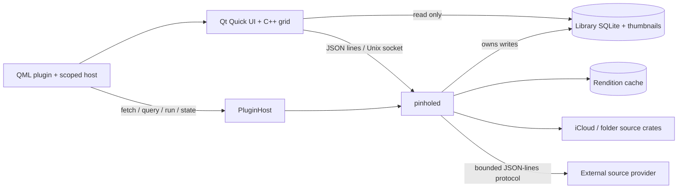

# Pinhole project review — 2026-11-03

Reviewed architecture, startup and rendering paths, interaction consistency,
plugin contracts, onboarding, documentation and the executable test suite.
Baseline: `d21d80d1f60bcc4cd8fd8e00577a38b70af7d7b9`. Findings below came
from source inspection, fresh measurements and tests; previous migration
notes were treated as history rather than proof that the current app passes.

Pinhole's main boundaries are sound. The most consequential findings are a
confirmed JPEG decoding difference in the pinned Blaze build, a multimedia
startup bottleneck, and unbounded diagnostic history. The latter two were fixed in the initial review. The remaining findings
were addressed in [the follow-up](2026-11-03-fixes.md), which records the
compiler correction, data repair and final delivery gates. Measurements
and failure counts below describe the original review stage.

## Findings, in priority order

| Priority | Finding | Status / next action |
|---|---|---|
| P1 | Blaze 0.20261030.1 produces different decoded JPEG pixels than Cargo and an independent decoder | Fixed in follow-up: pinned SIMD packing correction, byte parity gate and derived-data repair. |
| P1 | Photo frame defeated background media initialization and blocked the GUI during startup | Fixed: create its slides/players on demand; native first frame 1007 → 416 ms median. |
| P2 | Frame timing samples grew for the lifetime of an app with the diagnostics overlay closed | Fixed: bounded deque of 65,536 samples, covered by a 70,000-frame test. |
| P2 | The plugin kit's sideways wheel retained the old one-step-per-turn limit, contrary to the main grid | Fixed in `Zoomer`, with a full-range/reversal regression test. |
| P2 | Plugin creation was hidden behind a long developer document and a folder button | Fixed: offline workshop in Settings, quick start, searchable reference, agent brief and machine-readable CLI docs. |
| P2 | A read-only plugin SQL query has a busy timeout, but no execution or result-size budget | Fixed in follow-up: interruptible native execution, queue/time/row/byte limits and documented errors. |
| P2 | The “missed frame” counter assumes 120 Hz on every screen | Fixed in follow-up: per-sample screen period, refresh changes and discontinuity handling. |
| P2 | General controls lack a complete accessibility contract | Fixed in follow-up: shared accessible semantics, modal focus containment, section navigation and narrow/large-font checks. |
| P2 | No checked-in CI pipeline enforces the combined C++/Rust/plugin/installer contract | Fixed in follow-up: pinned container, separate compiler/Rust/reference/Qt/visual/Wayland jobs. |
| P3 | Orchestration and protocol code are large and hard to change independently | Split in follow-up: plugin jobs/checker/library/query, QML plugin plane and frame monitor; hot grid path retained. |

## The compiler finding is a correctness issue

`BLAZE_TESTS=all bin/build-rust test --release --workspace --no-fail-fast`
completed the core workspace with **119 passed, 1 failed**. The failure is
`gainmap::tests::a_map_attached_is_read_back_by_libultrahdr`. A targeted run
through Cargo, into a separate target directory, passes the unchanged test.
The difference reproduces outside Pinhole using only `zune-jpeg 0.5.15`
and `zune-core 0.5.1`: a synthetic JPEG ramp returns repeated pixel pairs
under Blaze, with a maximum error of 255; Cargo and Pillow read the ramp
correctly. Both normal and scalar-requested decoding show the problem, so
calling it simply an AVX bug would be premature.

The encoded JPEG itself is correct when read independently. Thus this
does not establish that the HDR writer corrupts exported JPEG bytes. It
does establish a problem in Rust JPEG decoding built by this compiler.
The potentially affected paths include thumbnail average colours and
Series analysis (`core/src/sync.rs`, `cover.rs`,
`plugins/series/finder/src/main.rs`). The C++ grid uses libjpeg-turbo and
separate decoders; this is not evidence that every grid thumbnail is bad.

[The standalone reproduction](jpeg-repro/README.md) contains the pinned
dependencies, source and synthetic fixture. No private photo is needed.
Blaze was the project builder at the time of this review.
Successful compilation and earlier rebuild-speed results cannot certify
runtime equivalence. The follow-up isolated and corrected `pack_lanes` in Blaze; see
[the compiler notes from that revision](https://github.com/ncr/pinhole/blob/3bfdc6f/docs/blaze.md). Changing decoder configuration alone did
not resolve the original reproduction.

## Startup and runtime performance

On a Ryzen 7 9800X3D / RTX 5080, Qt 6.12, 49,092 photos and all 16 plugins:

| Measurement | Before | After |
|---|---:|---:|
| Native Wayland first frame, median of five | 1007 ms | 416 ms |
| Xvfb first frame, median of five | 916 ms | 463 ms |
| Xvfb visible thumbnail cells resolved | 971 ms | 498 ms |

The complete method, ranges, service timing and raw evidence are in
[startup-performance.md](../startup-performance.md). These are warm
application launches from `main`, not a cold OS boot. Media integration
still takes about 0.9 s, but no longer holds the first grid behind it.
The native runs used hidden workspace 5; the virtual runs used explicit
`xcb`, not an inherited `wayland;xcb` setting.

The grid's design is appropriate for large libraries: arithmetic layout,
visible-item decoding, demand-prioritized work, stale-generation rejection,
texture upload/eviction budgets and progressively sharper renditions. The
two-full-decode limit is particularly important for portrait/HDR originals.
Do not replace that with a QML delegate per library asset or download
originals globally to solve sharpness.

The old 120 Hz / 100k-photo Asahi results in `grid-spike.md` describe that
hardware and revision. They are not current measurements on this NVIDIA
machine. The diagnostic counter currently calls every interval above
12.5 ms “missed”, so its count is misleading on a 60 Hz screen even when
raw intervals are correct. Frame pacing should be measured on a visible
or controlled nested compositor, not inferred from a hidden window that
the compositor may suspend.

A current 5,000 px/s smoke benchmark on Xvfb (1400×900, 48,854 grid cards)
gave frame intervals p50 13.6 ms, p99 16.8 ms, max 40.8 ms, with no visible
placeholders. The grid's own sync work was p50 0.02 ms, p99 0.12 ms. The
counter called 100% of frames missed under its fixed 120 Hz assumption;
this is evidence for correcting the counter, not a native-display FPS
claim. The large first-render interval remains a better optimization
target than the grid's already small geometry cost.

## Architecture

Good decisions worth preserving:

- One service owns library/cache mutation; the UI's database connections
  are read-only. Reloads preserve stable photo ids and reject stale work.
- Source traits keep cloud and folder logic out of the grid. External
  providers have a documented lifecycle, line/batch limits, liveness checks
  and tests for disconnects, malformed data and large catalogs.
- Plugin jobs have lifecycle/cancellation handling; settings, user state
  and derived cache are distinct and written atomically. Disabling a source
  plugin hides it without deleting its source or photos.
- The Unix socket is user-only (`0600`). Plugins/providers still execute
  with the user's permissions; this is a trust boundary, not an OS sandbox.
- Developer updates and package-manager updates have separate ownership.
  The source installer preserves a running UI on failed build and restores
  its arguments/environment after a successful install.

Where complexity is accumulating: `Main.qml` is about 2,000 lines,
`plugins.cpp` about 3,200, `photogrid.cpp` about 3,000, and both the core
service and provider implementation exceed 2,000. Extract the plugin
manifest/checker, jobs, library/query API, and UI overlay/action collection
at existing boundaries. Keep the scene-graph hot path together until
profiling justifies a split; file length alone is not a reason to rewrite it.

`PluginHost::query` correctly waits off the GUI thread for SQLite locks.
However, `QSQLITE_BUSY_TIMEOUT=5000` is only a lock wait. A recursive query
or huge result can consume CPU/memory indefinitely, and cancellation is
checked only as rows are returned. An execution budget and bounded results
are the next concrete API hardening step.

## UI/UX and plugin documentation

The app has a coherent photo-first interaction model: shared theme,
keyboard hints, unified scroll physics, nonmodal copy feedback and
progressive detail. The sorting picker already has explicit selected,
hovered, pressed and keyboard states. The generic zoom component had
drifted from the grid; this review fixes that mismatch.

The new **Settings (Tab) → Plugins → Build a plugin** opens a lazy offline
workshop. It offers a short introduction, use cases, section search,
keyboard navigation, selectable/copyable code, internal reference links,
API version, a public source-provider contract and agent instructions. The
follow-up removes internal service/schema/HDR implementation notes from this
author-facing handbook.
Its chrome is localized; the technical reference is English. It reads
the same embedded Markdown as `pinhole plugin docs --json`, including in
packaged builds. There is no required network request or second copied
API reference to maintain.

The public API already covers useful workflows: custom views, marks,
grouping/hiding, file generation, undo, clipboard, async jobs, colour-aware
images, source discovery/sign-in and external providers. The missing piece
was a short path from an idea to a working, checked plugin. The quick start
and agent contract now make lifecycle, startup cost, id stability, errors,
translations and trust explicit. The contract also corrects a stale claim:
library positions remain capture-date ordered while the main grid can use
Automatic or addition-date ordering.

Next UX work should prioritize discoverability and accessibility over more
features: simplify the long settings panel into clear navigation, audit
focus traversal and names/states of `ShellButton`/`Toggle`, and test narrow
windows, larger fonts, light themes and screen-reader output. The workshop
uses the same restrained controls and keeps its contents off the launch
path. Avoid an automatic tour or modal update notice at every startup.

## Verification and remaining limits

- Full Qt suite at the initial review stage: **160 passed, 6 skipped**.
  Four skipped render cases were then run on Xvfb. The two data-dependent
  skips need explicit HDR/decode sample folders; they were not called passes.
- Final focused tests cover the new handbook, bounded diagnostics,
  translations, generic zoom and grid-wheel regressions.
- Installer/updater/restart tests: **36 passed**. Calendar logic: **9 passed**.
- All **16 plugin checker runs passed**. The checker is static validation,
  not a security audit or proof of every interaction.
- App self-tests on Xvfb exercise the workshop's lazy loading, reference links,
  private clipboard, section search, keyboard navigation, Escape and narrow
  layout, plus the deferred Calendar and Photo frame actions.
- Rust: **119 passed, 1 failed under Blaze**; unchanged HDR test passes under
  Cargo. Do not describe the complete project check as green.

Headless entry points now explicitly select a generic Qt platform theme:
an inherited GTK theme could try to open the real display even when the
test selected `offscreen`. `app/bin/test` also accepts test method names.
The Photo frame self-test now targets the real plugin id and checks the
frame is destroyed when disabled, instead of only observing a viewer that
was already closing.

The follow-up completes the compiler, CI, query, frame-budget and
settings/accessibility fixes. Continue reducing warm startup toward 300 ms
through measurements; that is a performance target, not an observed result.
No broad rewrite is justified by these findings.
