# Pinhole's plugins

Every plugin is one key away. They go from the ones I use every day to the ones that exist because I could
imagine them. Each clip below is the real application, recorded on a library of a thousand of my photos where
the only face is mine.

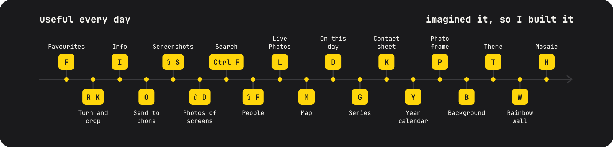

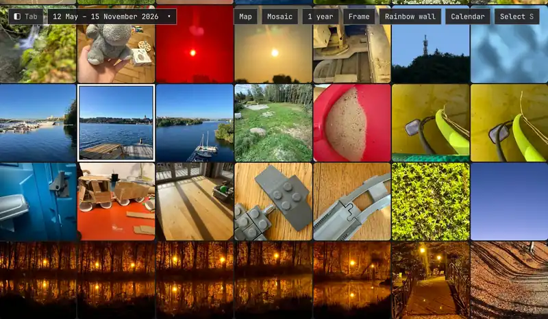

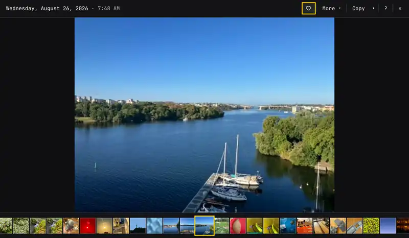

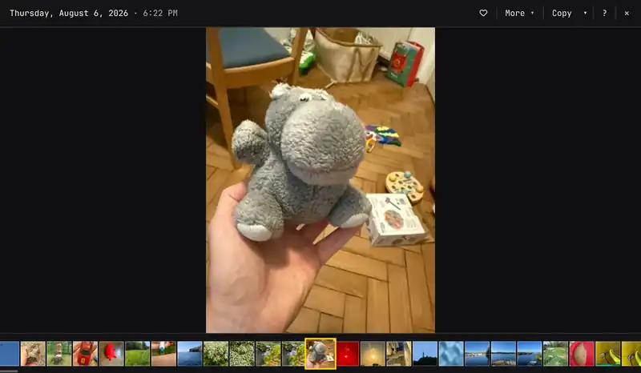

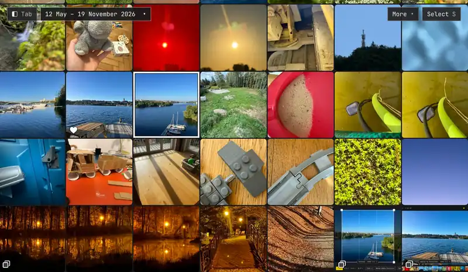

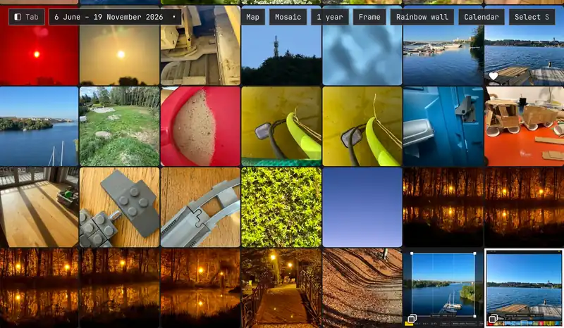

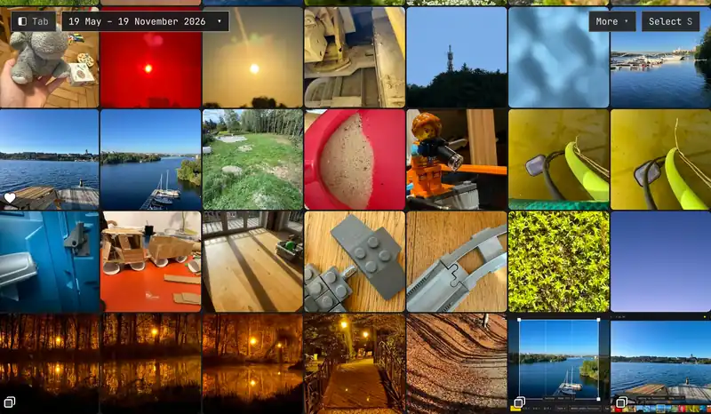

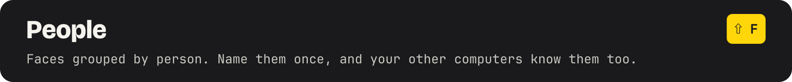
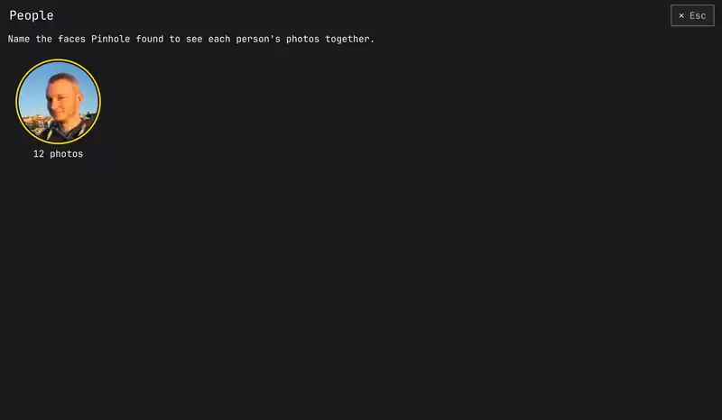

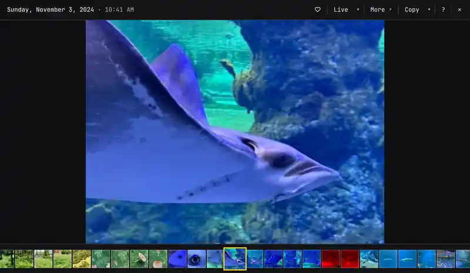

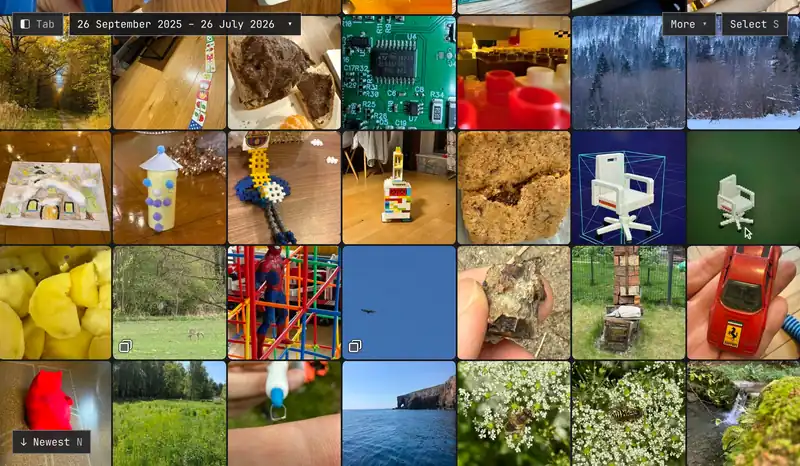

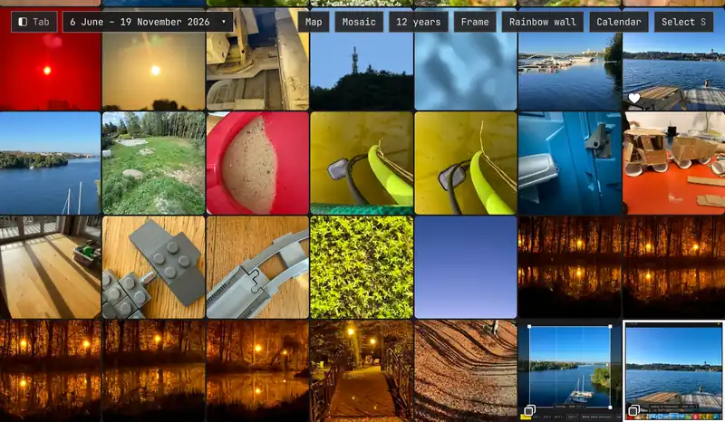

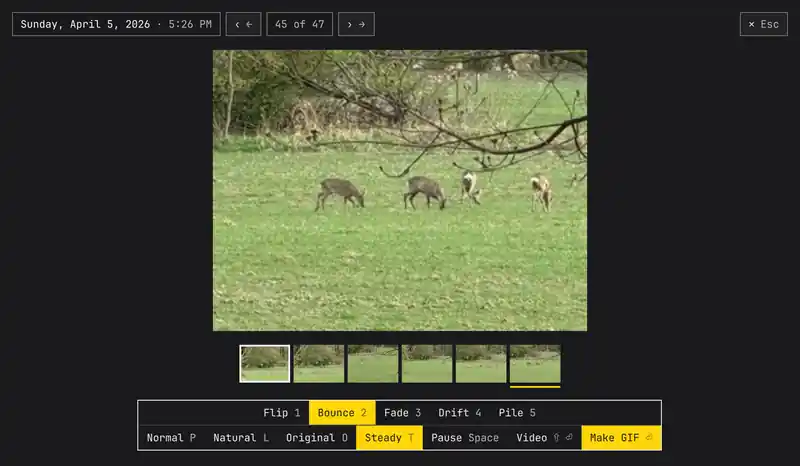

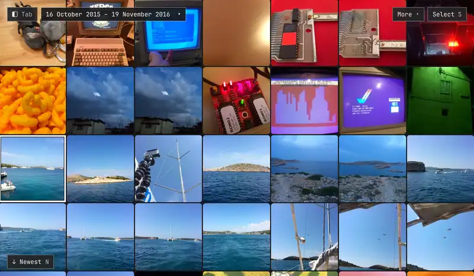

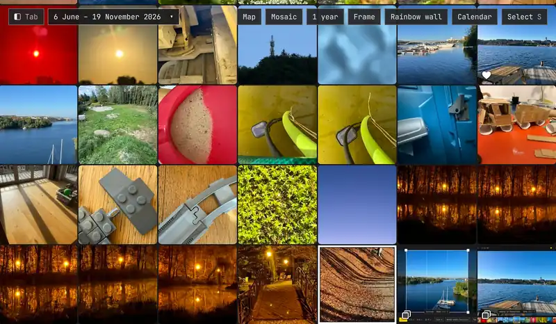

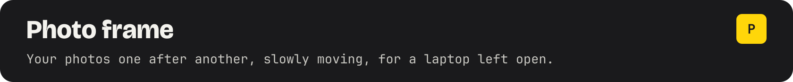

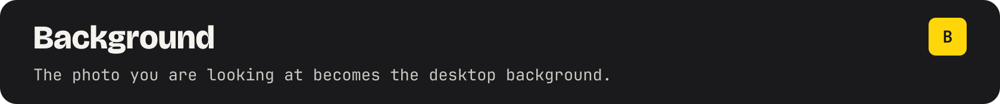
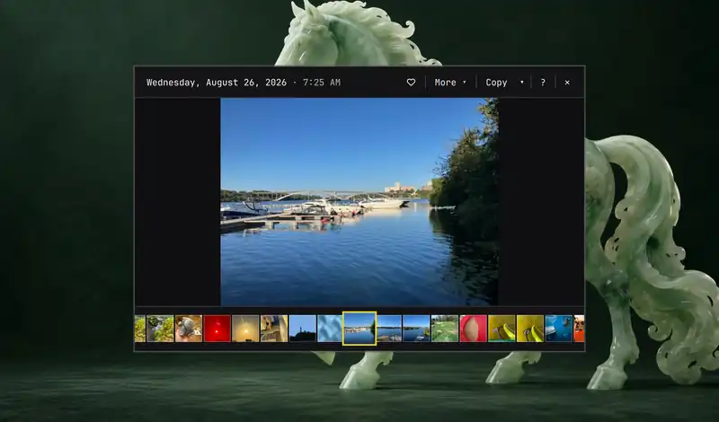

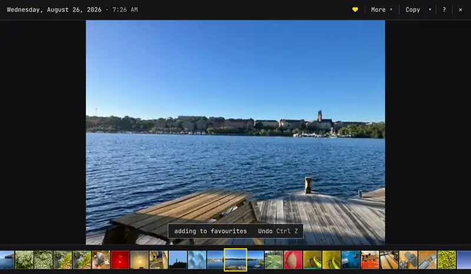

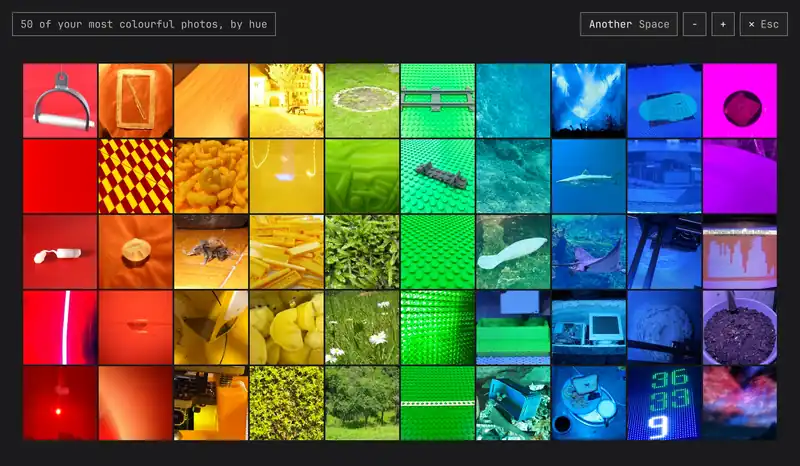

## More about them

- Every key and setting of each plugin: [What Pinhole does](../features.md)
- Turn plugins on and off in Pinhole's side panel: press <kbd>Tab</kbd>.
- Want one that is not here? [Build it with your AI agent](../../README.md#build-a-plugin-with-your-ai-agent).
